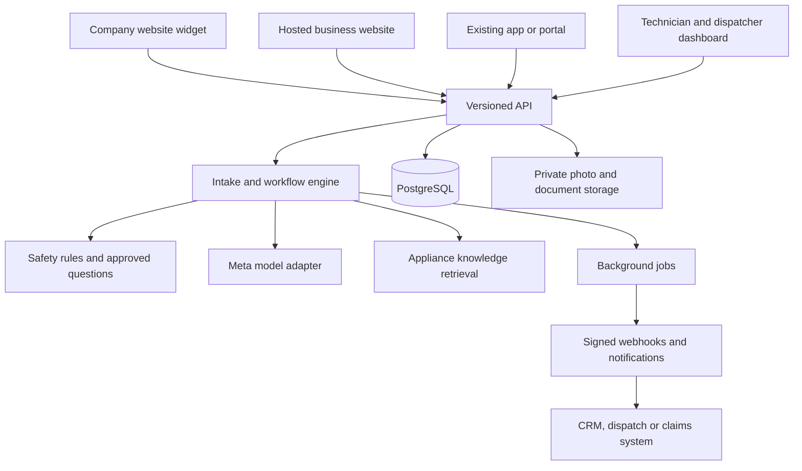

# MendCue — Architecture and Build Specification

Prepared: October 29, 2026.

Product name: **MendCue**.

Tagline: **From customer symptoms to repair-ready handoffs.**

GitHub organization: [ker2i](https://github.com/ker2i).

Intended repository: `ker2i/mendcue` (a target name; repository creation is a separate step).

Status: product design and implementation specification; this document does not imply that the application has been implemented.

This specification describes an embeddable appliance service intake platform for solo repair technicians, repair companies, home-warranty businesses, and insurers. The first pilot is a solo appliance repair technician in Phoenix, Arizona. The platform must also integrate into an existing company's website or app.

Business details for the pilot are intentionally configurable and have not yet been supplied. Do not invent them.

## 1. Hackathon timing and feasibility

The official Meta Global AI Developer Hackathon page lists submissions closing **November 4, 2026, at 9 p.m. Eastern**, with judging November 4–8 and winners announced November 9. That deadline is **November 5 at 7 a.m. in Tashkent**, or **November 4 at 7 p.m. in Phoenix**. The appropriate track is **Indie Developer**, under the **Build for Your World** theme. [Official event page](https://dev.meta.ai/events/global-hackathon)

Starting October 29 leaves roughly one week. The planning estimate is **50–65 focused development hours with coding-agent assistance** for the hackathon scope below. This is an estimate, not a delivery guarantee.

That is enough for a functioning platform foundation and supervised pilot. Comprehensive US appliance knowledge and production integration with an insurance corporation require subsequent work.

The public event information confirms the schedule, tracks, and themes. The full waiver could not be inspected because its page rendered only a loading screen. **Check the participant portal for video length, repository requirements, and any requirement to update the accepted project idea.** These details remain unverified. Event and API information in this document was researched on October 29, 2026; recheck information that can change before submission or implementation.

## 2. Product definition

Build a business-facing platform that conducts appliance service intake on behalf of an organization.

The assistant should:

- Understand the customer's description.
- Identify the appliance, including through label photographs.
- Ask the questions a dispatcher or technician would normally ask.
- Collect safe observations that help distinguish possible causes.
- Identify situations requiring immediate escalation.
- Produce an organized, evidence-linked handoff.
- Deliver that handoff to a technician, dispatcher, or external business system.
- Collect the eventual repair outcome to measure usefulness.

The immediate business value is **less repetitive questioning and better preparation before the visit**.

The product's assessment is preliminary. The technician records the confirmed diagnosis.

Use **MendCue** as the platform name. The name reflects turning customer symptoms into useful clues that help the service team prepare for a repair. Keep the platform name separate from each customer organization's branding. Embedded deployments must support the tenant's branding.

## 3. Product architecture and distribution

One backend must support all three interfaces from the beginning.

| Interface | Intended use | Hackathon scope |
|---|---|---|
| Embedded website widget | Repair companies and insurers adding intake to an existing website | Implement |
| Headless REST API | Existing mobile apps, customer portals, and business systems | Implement core endpoints |
| Hosted service website | Businesses without a website, including the Phoenix pilot | Implement a small configurable site |

The hosted website must consume the same intake API and components used by the widget.

Do not hardcode the pilot repairman's identity, Phoenix service area, questions, or contact details into the engine.



The major separation is between **the shared intake engine** and **organization-specific configuration**.

## 4. Organization model

A tenant represents one customer organization.

Supported organization types:

```text
solo_repair
repair_company
home_warranty
insurance
```

These types supply default terminology and workflow settings. They must not select separate implementations.

| Setting | Solo repairman | Repair company | Insurer |
|---|---|---|---|
| Customer-facing language | Request appliance service | Start a service request | Report an appliance issue |
| Initial destination | Owner's inbox | Dispatch queue | Intake or claims queue |
| Optional reference | Existing job number | Work order number | External claim reference |
| Human reviewer | Technician | Dispatcher or technician | Handler or assigned service provider |
| Main integration | Dashboard/email | Dispatch or CRM | Claims platform |

A tenant configuration must include:

```text
Organization name and type
Branding and public contact information
Timezone and supported languages
Allowed website origins
Supported appliance categories
Service ZIP codes or unrestricted intake
Required intake fields
Approved question/playbook versions
Routing destination
Notification settings
Webhook endpoints
Retention settings
Privacy and consent text
Feature flags
```

The pilot tenant should use `America/Phoenix`. Store timestamps in UTC and render appointments and preferences in the tenant's timezone.

## 5. Release boundaries

Implement the following before the hackathon deadline.

| Capability | Required for submission |
|---|---|
| Tenant-aware backend and data isolation | Yes |
| Two configurable demonstration tenants | Yes |
| Embedded chat on a separate website origin | Yes |
| Hosted pilot website | Yes |
| Text conversation | Yes |
| Appliance label and error-display photographs | Yes |
| Adaptive questioning | Yes |
| Reviewed safety and escalation rules | Yes |
| Three detailed appliance category playbooks | Yes |
| Small, verified manual collection | Yes |
| Technician dashboard and editable handoff | Yes |
| Structured JSON export | Yes |
| Signed handoff webhook | Yes |
| Repair outcome feedback | Yes |
| Actual claims-system connection | Later |
| Live phone calls | Later |
| Automatic appointment booking | Later |
| Parts ordering and payments | Later |
| Enterprise SSO and dedicated deployments | Later |
| Comprehensive national appliance catalog | Ongoing |

Use **refrigerators/freezers, washing machines, and dishwashers** for the first detailed playbooks.

Accept other appliance categories through a general intake path and human handoff. Their presence in the category selector must not imply that detailed troubleshooting is available.

## 6. Customer experience

The default journey should take approximately three to six minutes, subject to pilot measurement.

The opening message should identify the business and explain the task:

> I'm the AI intake assistant for [business]. I'll collect details about your appliance problem and prepare them for the service team. You can ask for a person at any time.

Provide:

- A short processing disclosure and consent control.
- “Talk to a person” throughout the conversation.
- “I don't know,” “Skip,” and “I can't safely check that” where relevant.
- Photo upload alongside text entry.
- A visible summary the customer can correct before submission.

Normal sequence:

1. Appliance category and free-text problem.
2. Immediate hazard screening.
3. ZIP code and service-area check.
4. Brand and model identification.
5. Relevant follow-up questions.
6. Optional approved observations or checks.
7. Contact details and preferred callback/visit times.
8. Customer review.
9. Explicit submission.
10. Confirmation and case reference.

Hazard messages must receive an immediate response even before consent or contact collection.

Collect ZIP code early. Collect a full street address only when the tenant requires it for service.

A preferred appointment window is a request. The interface must not show a confirmed appointment until a human or real scheduling integration confirms it.

## 7. Conversation behavior

The assistant should ask questions that change the handoff or narrow the plausible issue.

Requirements:

- Ask one main question per turn.
- Extract multiple answers when the customer supplies them together.
- Avoid asking for information already provided.
- Allow unknown brand, model, age, and serial number.
- Ask about contradictions instead of silently choosing an answer.
- Preserve customer corrections.
- Stop optional questioning when the customer requests handoff.
- Normally ask no more than ten diagnostic follow-up questions.
- Allow the customer to submit an incomplete intake with missing information marked.
- Preserve answers across a page refresh within the session lifetime.

Example:

> Customer: “My washer fills, then stops. It's an LG and says OE.”

The next response should account for all three facts. It should not ask whether the machine fills or what brand it is.

Error codes must remain verbatim until the exact model or an approved applicable source establishes their meaning.

## 8. Appliance identification

Support manual entry and photographs.

For label photographs, extract:

```text
Brand
Model number
Serial number, when present
Appliance category
Visible electrical or fuel information
Extraction uncertainty
Attachment reference
```

Display the extracted model number for confirmation:

> I read the model as ABC123. Is that correct?

Rules:

- Store raw label text and normalized search text separately.
- Preserve suffixes and punctuation in the original model.
- Treat OCR confusion such as `O/0` and `I/1` as unresolved.
- Never manufacture missing characters.
- Never equate a similar model with an exact match.
- Never request moving a heavy appliance or removing a panel to find a label.
- Allow “label inaccessible” and continue intake.

Use manufacturer-specific label-location guidance only when a reviewed source supports it.

Meta documents image input and text extraction for Muse Spark, including inline image data, which suits private label photographs. [Meta image understanding documentation](https://dev.meta.ai/docs/image-understanding)

## 9. Appliance knowledge and US coverage

The long-term product should accept intake for any US household appliance brand or model. Verified knowledge coverage must be tracked separately.

Use three knowledge levels:

| Level | Available knowledge | Permitted behavior |
|---|---|---|
| Exact model | Approved documentation explicitly covers the model | Applicable model-specific questions and information |
| Category or verified family | Approved general playbook or documented model-family relationship | General questions and clearly scoped information |
| Unknown | No verified applicable information | Collect symptoms and prepare human handoff |

Customer-facing coverage language should be:

> We accept service requests across appliance brands. Model-specific guidance depends on available documentation.

The model's memory must not be treated as the appliance database.

Knowledge sources should include:

- Manufacturer owner manuals and official support articles.
- Technician-approved category playbooks.
- Licensed technical information where subsequently obtained.
- CPSC recall records.
- Tenant-private approved procedures.

For example, GE provides model-based manual lookup, including documentation for older appliances. This supports a manufacturer-specific acquisition strategy. It does not establish universal coverage. [GE manual lookup](https://www.geappliances.com/ge/service-and-support/literature.htm)

For the hackathon, curate **roughly 6–12 real models across the three detailed categories**. Choose models for which actual usable documentation can be obtained. Do not invent manual contents, model applicability, or page citations.

## 10. Knowledge ingestion and retrieval

Start with exact identifiers and PostgreSQL full-text search. Keep a retrieval interface that can later accommodate embeddings.

Ingestion sequence:

1. An administrator uploads a document or selects an approved source URL.
2. Record source, publisher, document type, hash, and usage basis.
3. Extract text while retaining page boundaries.
4. Create page-linked chunks.
5. Specify the exact models or categories covered.
6. Review extracted content and applicability.
7. Publish an immutable approved version.

Scanned documents with unusable text must remain unpublished until their content can be extracted and reviewed.

Each document needs:

```text
document_id
visibility: shared | tenant_private
tenant_id, when private
publisher
source_url
document_type
title
language
brand
explicit_model_applicability
retrieved_at
document_hash
version
review_status
reviewed_by
```

Each chunk needs document version, PDF page index, printed page label when available, and applicability metadata.

Retrieval order:

1. Confirmed exact model.
2. Explicitly verified model-family applicability.
3. Approved brand/category material.
4. Approved generic category playbook.

A fuzzy text match must never automatically establish model applicability.

At generation time, pass only a small set of relevant chunks. Validate that every returned citation refers to a supplied chunk and supports the associated statement.

Keep tenant-private documents isolated in retrieval, caching, and model requests.

## 11. Safety and customer checks

Safety behavior belongs in application rules and reviewed content, with the model assisting classification.

Immediately interrupt normal intake for reports of:

- Suspected gas leaks.
- Smoke, flames, or active sparking.
- Electrical shock.
- Water contacting electrical equipment.
- Other clearly dangerous operating conditions.

For Phoenix gas-leak guidance, use a reviewed script based on Southwest Gas: leave the area, avoid operating switches or appliance controls, and call emergency services and the gas utility from a safe place. Keep the utility contact configurable by service area. [Southwest Gas safety information](https://www.swgas.com/en/safety/)

The assistant must not direct customers to:

- Remove covers or access energized components.
- Perform live electrical measurements.
- Bypass interlocks or protective devices.
- Work on gas connections.
- Handle refrigerant or sealed-system repairs.
- Repeatedly reset tripping electrical protection.
- Move heavy appliances.

Every suggested customer action must come from a **versioned, approved action registry**.

An action record must contain:

```text
action_id
customer-facing instruction
applicable categories/models
preconditions
hazard exclusions
required source or approved playbook
expected observation
stop conditions
review status and version
```

Examples of generally useful observations include reading an already visible display, describing when the failure occurs, or photographing an accessible label. Even routine operational checks must satisfy their recorded preconditions.

If the assistant cannot safely choose a next step, it should collect remaining descriptive information and offer handoff.

## 12. Recall behavior

Include a recall lookup interface in the architecture. Implement it after the main intake flow if time permits.

CPSC publishes machine-readable recall data through an official API. [CPSC recall API information](https://www.cpsc.gov/Recalls/CPSC-Recalls-Application-Program-Interface-API-Information?language=en)

Required recall states:

```text
not_checked
possible_match
confirmed_match
no_match_found
unavailable
```

A brand or product-name match is only a possible match.

Confirmation requires satisfying the notice's actual applicability conditions, which may include model, serial range, or manufacturing date.

Show the official notice, retrieval timestamp, and matching basis.

“No match found” must not be presented as a guarantee that the appliance has no recall.

## 13. AI implementation

Use Meta models for the application's runtime reasoning.

Recommended initial configuration:

```text
Provider: Meta Model API
Base URL: https://api.meta.ai/v1
Default text/vision model: muse-spark-1.3
Mode: Standard
```

The official documentation lists that model and API base URL. Use direct HTTPS requests from the server and keep the model behind an adapter. [Meta Model API overview](https://dev.meta.ai/docs/overview)

Use Standard mode for customer information. Meta states that Standard-mode content is not used to train its models; Contributor mode may use submitted content for training. This distinction does not establish every retention or contractual requirement an insurer may have. [Meta model documentation](https://dev.meta.ai/docs/models)

Implement these internal functions:

```typescript
interface ModelProvider {
  extractIntakeTurn(input: IntakeTurnInput): Promise<IntakeTurnResult>;
  extractApplianceLabel(input: LabelInput): Promise<LabelResult>;
  assessCase(input: AssessmentInput): Promise<AssessmentResult>;
}
```

Normal text turns should generally require one structured extraction/classification call. Additional calls are appropriate for photographs and final assessment.

Responsibilities:

- The model extracts proposed facts and suggests a useful question.
- Application code validates facts and chooses allowed transitions.
- The model suggests preliminary hypotheses using supplied evidence.
- Application code controls customer actions, routing, permissions, and submission.

Use Meta's documented JSON Schema output capability, followed by independent server-side schema and business-rule validation. [Structured output documentation](https://dev.meta.ai/docs/structured-output)

Do not stream unvalidated model output directly to customers.

## 14. Processing a customer turn

Implement the following pipeline.

```text
Authenticate case/session capability
    ↓
Validate message and attachments
    ↓
Persist customer message and enqueue processing
    ↓
Run immediate deterministic hazard checks
    ↓
Extract proposed facts and semantic hazard signals
    ↓
Validate facts and resolve conflicts
    ↓
Apply safety and workflow rules
    ↓
Retrieve applicable knowledge if needed
    ↓
Choose an allowed question, action, or handoff
    ↓
Validate and persist the response
    ↓
Deliver response to the client
```

A model result can use this contract:

```typescript
type IntakeTurnResult = {
  proposedFacts: Array<{
    key: string;
    value: string | number | boolean | null;
    sourceMessageId: string;
    sourceAttachmentId: string | null;
    certainty: "explicit" | "inferred" | "uncertain";
  }>;

  hazardSignals: Array<{
    type: string;
    evidenceText: string;
    possibleCurrentDanger: boolean;
  }>;

  suggestedQuestionId: string | null;
  suggestedActionId: string | null;

  needsClarification: boolean;
  handoffRequested: boolean;
  unresolvedItems: string[];
};
```

The server must verify that the suggested IDs exist, are enabled, and satisfy the current case's preconditions.

A customer message, uploaded document, or photograph can contain malicious instructions. Treat their contents as untrusted evidence. They must not change application policy, reveal prompts or secrets, or trigger arbitrary network access.

## 15. Failure behavior

The service must remain useful when the AI cannot respond.

On timeout, rate limit, refusal, invalid output, or unavailable model:

- Preserve the customer's submitted message.
- Make at most one bounded retry where appropriate.
- Switch to a deterministic intake form or approved question sequence.
- Offer immediate handoff.
- Mark the handoff with `assessment_unavailable`.
- Produce a factual summary from collected fields.
- Log the technical reason for operators without exposing it to the customer.

Suggested customer wording:

> I can still collect your details and send them to the service team.

Do not repeatedly rephrase requests to evade model refusals.

A model outage must not lose an intake or prevent a customer from requesting human assistance.

## 16. Technician handoff

This is the primary product output.

The handoff must be understandable in approximately one minute and contain:

```text
Case reference and submission time
Organization and intake source
Customer contact details
Service location or ZIP
Appliance category, brand and model
Model-identification status
Customer's original complaint
Structured symptoms and timeline
Exact displayed error codes
Hazards and escalation actions
Checks attempted and observed results
Preliminary hypotheses
Evidence and applicable sources
Missing information
Customer's preferred contact/visit windows
Recommended human follow-up
Relevant attachments
Assessment and handoff version
```

For each hypothesis, include:

```typescript
type Hypothesis = {
  issueArea: string;
  priority: "primary" | "alternative";
  evidenceStrength: "limited" | "moderate" | "strong";
  supportingFactIds: string[];
  contradictingFactIds: string[];
  sourceChunkIds: string[];
  limitations: string[];
};
```

Show no more than three hypotheses.

Do not display invented probability percentages. Evidence strength is a qualitative description of available support, not a calibrated likelihood.

When model-specific evidence is unavailable, label the assessment accordingly. If the evidence does not support a useful hypothesis, say that technician diagnosis is required.

Exclude automatic part-number recommendations from the initial release.

## 17. Technician and dispatcher dashboard

Build a responsive interface suitable for a phone between service calls.

Required views:

- Login.
- Case inbox.
- Case detail.
- Knowledge review.
- Organization settings.
- Integration settings.
- Basic pilot metrics.

The inbox should show appliance, complaint, ZIP, urgency, status, and submission time.

The case detail should show the handoff first, with transcript, photographs, citations, and audit history available below it.

Required actions:

```text
Accept/review case
Assign to a staff member
Correct extracted facts
Add internal notes
Mark customer contacted
Record a confirmed appointment
Close or cancel case
Record final repair outcome
Export handoff JSON
Print a readable handoff
```

Keep customer statements, AI hypotheses, and technician-confirmed findings visually distinct.

Record technician corrections as new events. Preserve the original submitted handoff.

An email notification, if configured, should contain a case reference and dashboard link. Avoid putting full transcripts and photographs into email.

## 18. Workflow and state

Keep conversation progress, operational status, and safety status separate.

```text
conversation_phase:
  consent
  identification
  questioning
  review
  submitted
  closed

workflow_status:
  draft
  new
  reviewing
  contacted
  scheduled
  closed
  cancelled

safety_status:
  unchecked
  no_hazard_reported
  needs_review
  stop_use
  emergency

disposition:
  pending
  ready_for_review
  human_requested
  customer_reports_resolved
  out_of_service_area
```

“No hazard reported” describes the intake evidence. It must not be presented as a certification of safety.

A customer reporting that the appliance works again is different from a technician confirming a repair.

Submission requires an explicit customer action and creates an immutable handoff snapshot. Subsequent changes create a new version.

## 19. Embedding contract

Provide a small loader script and an iframe-based interface.

Example integration:

```html
<script
  src="https://PLATFORM_HOST/widget/v1.js"
  data-public-key="pk_ORGANIZATION"
  data-mode="launcher"
  defer>
</script>
```

Support `launcher` and `inline` modes.

The public key identifies an organization's public widget configuration. It is not a secret and grants no access to existing cases.

Implementation requirements:

- Validate the organization's configured website origins.
- Scope each customer session to one case and tenant.
- Use short-lived, single-use bootstrap codes.
- Transfer bootstrap codes to the iframe using strictly checked `postMessage`.
- Validate both message origin and source window.
- Use bearer capabilities inside the iframe rather than depending on third-party cookies.
- Never put session capabilities in URLs.
- Keep service API keys out of browser code.
- Apply per-tenant, session, and network abuse limits.
- Offer a full-page intake link when embedding is blocked.

Origin allowlisting helps control browser embedding. It does not authenticate anonymous customers or prevent non-browser abuse.

Expose only non-sensitive host-page events:

```text
intake.opened
intake.submitted
intake.closed
intake.error
```

Do not send transcripts, contact details, or photographs through host-page events.

## 20. API contract

Publish an OpenAPI specification under `/api/v1`.

| Endpoint | Purpose | Authorization |
|---|---|---|
| `GET /public/widget-config/{publicKey}` | Public branding and enabled features | Public |
| `POST /public/sessions` | Start an anonymous intake | Public key, origin and abuse checks |
| `POST /sessions/exchange` | Exchange one-time bootstrap code | Single-use code |
| `GET /cases/{caseId}` | Read allowed case state | Case capability or scoped staff/service access |
| `POST /cases/{caseId}/messages` | Submit customer message | Case capability |
| `GET /cases/{caseId}/events` | Receive validated progress and responses | Case capability |
| `POST /cases/{caseId}/attachments` | Upload photograph | Case capability |
| `PATCH /cases/{caseId}/facts` | Correct customer-provided information | Appropriate case/staff access |
| `POST /cases/{caseId}/submit` | Confirm handoff | Case capability |
| `POST /cases/{caseId}/request-human` | Request human assistance | Case capability |
| `POST /integration/sessions` | Start intake from a business's backend | Scoped service key |
| `GET /integration/cases/{caseId}/handoff` | Retrieve structured handoff | Scoped service key |
| `GET /staff/cases` | Organization inbox | Staff session |
| `PATCH /staff/cases/{caseId}` | Assignment and operational updates | Staff role |
| `POST /staff/cases/{caseId}/outcome` | Record repair outcome | Staff role |

Use:

- Opaque UUID identifiers.
- Hashed bearer credentials at rest.
- `Idempotency-Key` for retryable creation and submission operations.
- Explicit request-size limits.
- Optimistic version checks for edits.
- Consistent error objects.

Example:

```json
{
  "error": {
    "code": "CASE_VERSION_CONFLICT",
    "message": "This case changed. Refresh before saving.",
    "request_id": "opaque-request-id"
  }
}
```

For the initial release, stream processing events and completed validated replies using SSE, with polling as a fallback. Token-by-token text generation is unnecessary.

## 21. External business integration

Implement one generic signed webhook mechanism.

Initial event types:

```text
case.submitted
case.handoff_updated
case.status_updated
case.closed
```

Example event:

```json
{
  "event_id": "opaque-event-id",
  "event_type": "case.submitted",
  "schema_version": "1",
  "occurred_at": "2026-11-01T18:00:00Z",
  "case_id": "opaque-case-id",
  "external_reference": null,
  "handoff_version": 1
}
```

Keep the webhook payload small. The receiving system retrieves permitted details using its scoped service key.

Requirements:

- HTTPS endpoints.
- Timestamped HMAC signatures over the exact request bytes.
- Unique event IDs.
- Retry with exponential backoff.
- Delivery history and manual retry.
- Documented duplicate handling.
- Per-case ordering information.
- No claim of exactly-once delivery.
- Administrator-managed destinations with SSRF protections.

For an insurer's existing app, its backend creates an intake session and supplies an authorized external reference. A customer must not be able to change a claim reference in browser code to access another case.

Build the generic integration contract before vendor-specific connectors.

## 22. Insurance-specific behavior

Support insurers through the same case engine.

Optional fields:

```text
external_customer_reference
external_claim_reference
policy_reference
reported_incident_date
reported_property_damage
reported_prior_repairs
service_provider_reference
```

Store only fields the tenant actually requires.

The assistant can organize reported facts and technical uncertainty. Coverage decisions remain with the organization's authorized process.

Keep separate:

- What the customer reported.
- What photographs show.
- What the assistant inferred.
- What a technician confirmed.
- What the insurer decided.

An insurer and an independent repair company must not gain access to each other's tenant records simply because they work on the same claim.

For the hackathon, demonstrate transfer through an authorized export or webhook. Later cross-organization collaboration should use explicit, audited case-sharing grants with defined recipients, fields, and expiry.

Production insurer onboarding may require SSO, contractual data controls, dedicated retention policies, and infrastructure changes. Describe these as later capabilities until implemented and validated.

## 23. Data model and tenant isolation

Use PostgreSQL with relational operational data and JSON where structures need controlled flexibility.

Core entities:

```text
tenants
tenant_settings
users
tenant_memberships
service_credentials
customer_sessions
cases
messages
case_facts
attachments
assessments
handoff_versions
case_events
knowledge_documents
knowledge_chunks
document_model_applicability
webhook_endpoints
webhook_deliveries
background_jobs
repair_outcomes
```

Every tenant-owned record must carry `tenant_id`.

Important constraints:

- Tenant-scoped foreign keys.
- Unique message/idempotency keys.
- Unique handoff version per case.
- Immutable published document versions.
- Immutable submitted handoff snapshots.
- Attachment ownership tied to its case.
- Provenance for extracted facts.

A fact record should retain:

```text
key and typed value
source message or attachment
reported / extracted / confirmed status
created time
superseded fact, when corrected
confirmation actor and time
```

Enforce tenant isolation through application authorization and PostgreSQL row-level security.

The runtime database role must not own protected tables or have permission to bypass row-level security. Set tenant context inside each database transaction, including worker operations.

Shared approved knowledge should use an explicitly separate visibility path. Private tenant documents must never become shared automatically.

Include tenant and authorization scope in cache keys. Do not cache private case responses publicly.

## 24. Suggested technical stack and repository

Use one TypeScript application with a separate worker process from the same repository.

| Component | Choice |
|---|---|
| Customer UI, dashboard and hosted site | Next.js and React |
| API | Next.js route handlers under `/api/v1` |
| Runtime validation | Zod |
| Database | PostgreSQL |
| Database access and migrations | Drizzle with SQL migrations |
| Jobs | PostgreSQL-backed queue |
| Model requests | Server-side HTTPS adapter |
| Initial private media storage | Persistent filesystem volume |
| Storage abstraction | Interface supporting later S3-compatible storage |
| TLS and reverse proxy | Caddy |
| Deployment | Docker Compose |
| Automated verification | Unit/integration tests and Playwright |

Pin supported package versions when implementation starts and commit the lockfile.

Next.js documents self-hosting and recommends a reverse proxy in front of the application server. [Next.js self-hosting guidance](https://nextjs.org/docs/app/guides/self-hosting)

Suggested layout:

```text
src/
  app/
    api/v1/
    embed/
    staff/
    business/
  domain/
    intake/
    safety/
    knowledge/
    assessment/
    handoff/
    tenancy/
  integrations/
    meta/
    storage/
    notifications/
    webhooks/
  db/
  worker/
  components/
  content/
    questions/
    playbooks/
    safety/

public/
  widget/v1.js

migrations/
tests/
docs/
  openapi.yaml
  architecture.md
  deployment.md
  tenant-onboarding.md
  evaluation.md

Dockerfile
compose.yaml
Caddyfile
.env.example
README.md
```

Keep business rules in `domain/`, independent of UI routes and model-provider code.

## 25. Background processing and reliability

Use durable jobs for model calls, photograph processing, document ingestion, handoff generation, and webhook delivery.

Requirements:

- Lease jobs with expiry so another worker can recover abandoned work.
- Bound attempts and retain failed-job diagnostics.
- Allow only one normal turn-processing job per case at a time.
- Make job completion idempotent.
- Perform slow model requests outside database transactions.
- Recheck case version and safety state before committing a generated reply.
- Discard stale output after a customer correction or emergency interruption.
- Commit handoff creation and its outbound event together through a transactional outbox.

The customer should see progress such as “Reading the label” or “Preparing your summary.”

After reconnecting, the client must recover the persisted result rather than resend the original message blindly.

## 26. Media, privacy, and access

Collect the information needed for service intake and explain which organization receives it.

Initial image policy:

```text
Accepted: JPEG, PNG, WebP
Maximum: 8 MB per image
Maximum: 8 images per case
Private storage only
Validate actual file type
Decode and re-encode accepted images
Strip location metadata
Generate model-friendly derivatives
```

If HEIC is unsupported, explain how the customer can upload another format. Do not silently fail.

Serve photographs through authenticated endpoints or short-lived signed access. Never place them in a public static directory.

For the pilot, describe sanitized photographs as customer-submitted intake material. If an insurer later requires original evidence preservation, add a separate controlled originals workflow with hashes, access records, and its retention requirements.

Additional requirements:

- Staff sessions use secure, HTTP-only cookies.
- State-changing staff actions have CSRF protection.
- Implement owner, dispatcher, technician, and read-only permissions.
- Assign permissions independently of the tenant's organization type.
- Keep model keys and webhook secrets server-side.
- Exclude contact details from model requests unless specifically necessary.
- Exclude transcripts and bearer credentials from ordinary logs.
- Record access to sensitive exports and staff modifications.

Suggested configurable defaults:

- Abandoned drafts: delete after seven days of inactivity.
- Closed-case transcripts and media: retain 90 days.
- Redacted operational logs: retain 14 days.
- Backups: expire within 30 days.

Implement deletion across database records, files, and derived data. Explain backup expiry accurately.

Use synthetic customers and claims in the public hackathon demonstration.

## 27. VPS deployment

Start with one VPS running four services:

```text
caddy
web
worker
postgres
```

Initial capacity estimate:

```text
4 vCPU
8 GB RAM
80+ GB persistent SSD
```

This is a starting estimate for a low-volume pilot, to be checked under load. The model runs through Meta's API, so the VPS does not require a GPU.

Deployment requirements:

- HTTPS domain.
- Only web ports exposed publicly.
- Private database network.
- Persistent database and media volumes.
- Restart policies.
- Encrypted off-server backups.
- Daily database and media backup.
- Documented restore procedure.
- One successful restore rehearsal before live customer use.
- Health checks for web, database, and worker.
- Versioned container images and rollback instructions.
- Explicit migration step during deployment.

The initial VPS is a single failure domain. Offer dedicated or more resilient infrastructure later when an organization's requirements justify it.

Required environment configuration should include:

```text
APP_BASE_URL
DATABASE_URL
MODEL_API_KEY
META_MODEL
SESSION_SECRET
SECRET_ENCRYPTION_KEY
MEDIA_STORAGE_PATH
EMAIL_PROVIDER_SETTINGS
BACKUP_SETTINGS
GLOBAL_AI_SPEND_LIMIT
```

The application must show an honest degraded state when a required integration is unavailable.

## 28. Hosted website for the pilot

Build a small website generated from tenant configuration.

Required content:

- Business name.
- Appliance categories served.
- Service area.
- Real contact details when supplied.
- Short description of the service process.
- “Start a service request.”
- Direct contact alternative.
- Privacy information.
- Embedded intake.

Do not invent reviews, certifications, guarantees, prices, or business history.

Until actual business details are configured, use a visibly labeled demonstration business and disable search indexing.

The website is an acquisition channel for the platform's first customer. Its intake must behave identically to the widget installed on an existing company website.

## 29. Pilot evaluation

Measure whether the assistant improves work for the repairman.

| Metric | Measurement |
|---|---|
| Intake completion | Submitted cases divided by started cases |
| Customer effort | Time and turns to submission |
| Handoff completeness | Required facts collected or explicitly unknown |
| Follow-up burden | Additional questions the technician still needed |
| Technician handling time | Actual time spent reviewing and completing intake |
| Model identification quality | Technician-confirmed correctness |
| Assessment usefulness | Technician rating and eventual confirmed issue |
| Cost per submitted case | Measured model usage and processing cost |
| Escalation behavior | Results on reviewed hazard scenarios |

Ask the repairman to grade each handoff:

```text
Useful as received
Useful after minor corrections
Needed substantial follow-up
Misleading or unusable
```

Record the confirmed issue and whether the preliminary hypotheses were useful.

For the first live cases, require the technician to review the intake before taking action.

Do not advertise hours saved or diagnostic accuracy based on synthetic examples. Establish a manual-intake baseline, then compare real pilot cases.

## 30. Verification and acceptance criteria

The implementation is ready for demonstration when these behaviors pass.

1. A customer completes an intake from a separate website origin.
2. The same engine works on the hosted pilot website.
3. A second tenant has different branding and routing without a code change.
4. Tenant A cannot read or modify Tenant B's cases, media, knowledge, exports, or jobs.
5. A label photograph produces confirmable model text.
6. An ambiguous model remains unresolved rather than becoming an exact match.
7. Unknown appliances can reach human handoff.
8. Questions reflect information already supplied.
9. Safety reports interrupt normal questioning.
10. Unapproved customer actions cannot be displayed.
11. A model failure falls back to usable intake.
12. Refreshing or retrying does not duplicate messages or submissions.
13. The handoff separates reported facts, hypotheses, and confirmed findings.
14. Citations resolve to the correct document version and page.
15. A signed webhook can be verified and safely retried.
16. Staff can record a repair outcome.
17. A backup can be restored.
18. Public demonstration data contains no real customer information.

Prioritize automated tests for authorization, tenant isolation, state transitions, action gating, idempotency, and webhook signatures.

Use a reviewed scenario set containing ordinary cases, ambiguous cases, unsupported models, hazard reports, and model failures. Do not use the same model as the sole judge of its own diagnostic quality.

## 31. Build schedule

Target a submitted project several hours before the official deadline.

| Date | Required result |
|---|---|
| Oct 29 | Repository, deployment skeleton, tenant schema, working Meta requests, question and safety contracts |
| Oct 30 | End-to-end text intake, durable jobs, case persistence, fallback intake |
| Oct 31 | Label photographs, model confirmation, approved knowledge retrieval |
| Nov 1 | Technician dashboard, handoff versions, outcome recording |
| Nov 2 | External widget, second demonstration tenant, API documentation, signed webhook |
| Nov 3 | Supervised technician review, integration tests, deployment and restore rehearsal |
| Nov 4 | Fix remaining blockers, record demo, finish submission |

If behind schedule, cut features in this order:

1. Visual polish beyond basic usability.
2. Recall automation.
3. Additional manuals and appliance playbooks.
4. Email notifications.
5. Advanced metrics and dashboard filters.

Keep tenant isolation, reliable submission, human handoff, safety behavior, and the functioning external embed.

A smaller verified knowledge collection is acceptable. Fabricated knowledge is not.

## 32. Cost model

Use measured token usage and configurable spending limits.

At research time, Meta listed Standard Muse Spark pricing at **$1.25 per million input tokens and $4.25 per million output tokens**. An illustrative case consuming 50,000 input tokens and 5,000 output tokens would therefore cost about **$0.084 in model tokens**, before any additional billable services. Actual cases must be measured. Recheck current pricing before launch. [Meta pricing](https://dev.meta.ai/docs/pricing-rate-limits)

Control costs through:

- Bounded conversation context.
- Structured case state instead of repeatedly sending the whole transcript.
- Limited retrieved chunks.
- Reusing photo-extraction results.
- Per-case and per-tenant limits.
- A global daily spending limit.
- Fallback to factual intake when limits are reached.

Track image-related usage as reported by the provider. Do not assume every case matches the illustrative estimate.

Self-hosting the application and calling a hosted model is the practical starting architecture for this pilot.

## 33. Hackathon demonstration

Prepare a short recording, with final duration determined by the submission portal.

Show:

1. The Phoenix repair business's hosted website.
2. A customer reporting a refrigerator, washer, or dishwasher problem.
3. A label photograph becoming a confirmed model.
4. Follow-up questions changing based on the customer's answers.
5. A technician receiving a useful brief with evidence and missing information.
6. The same widget inside a second company's website.
7. A structured handoff delivered to a mock business-system receiver.
8. One graceful failure or escalation.

Label the second organization and receiver as demonstrations.

Explain Meta's contribution concretely: **multimodal appliance identification, interpretation of customer language, adaptive questioning, and evidence-based handoff preparation**.

Present pilot findings only after the repairman has actually reviewed them.

## 34. Instructions for Muse

Give Muse this specification with the following execution instruction:

> Build the platform described above as a working TypeScript repository. Follow the hackathon scope and schedule. Implement one shared tenant-aware intake engine used by the embedded widget, hosted website, staff dashboard, and REST API.
>
> Start by proving one complete text intake through to a persisted technician handoff. Then add label photographs, approved knowledge retrieval, external embedding, and the second tenant.
>
> Keep organization identity, service area, wording, routing, and enabled playbooks configurable. Use clearly labeled demonstration businesses until real details are supplied.
>
> Implement real Meta API integration behind a provider adapter. Supply a clearly labeled development fixture mode, but never present fixture output as a live model result.
>
> Preserve provenance, unknown values, customer corrections, and document applicability. Implement reviewed customer actions, tenant isolation, reliable background processing, and graceful model failure.
>
> Deliver the application, migrations, seed data, Docker deployment, environment template, OpenAPI specification, integration example, meaningful tests, evaluation scenarios, and operating documentation.
>
> Report which features work, which were verified, and which remain incomplete. Do not claim insurer production readiness or universal appliance knowledge.

The product to prove this week is **a reusable intake platform that prepares better service cases**. The Phoenix pilot supplies the first real workflow and the evidence needed to expand it.
